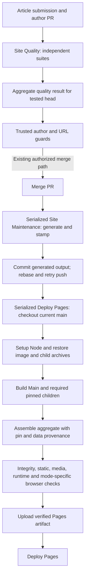

# P-01 build and publishing pipeline

| Baseline | Pinned code SHA |
|---|---|
| Main | `58273df6d753510605468c0787d9cdf04d6d398e` |
| Telemetry | `38c3dd2018b810a5dce1add1f7663bcb199c845a` |
| Ghost Car | `13fc12afb7c73ccbab6e71fc3d3210d922038d51` |
| TYRES | `249aa796a1981be4f70213c9f1973b4418faf3ca` |
| BetCast | `74eeb98b4acb1b4e0ea45d4ab12f7fdf4e0c2650` |

**Evidence date:** 2026-11-10 UTC. **Scope:** pinned Main Actions/build/publishing source, twelve captured successful historical workflow runs, local Gate E logs and child-cache timing objects. No publication, workflow trigger, build or browser was run for this report.

**Evidence key:** `M:path:line` means Main at the SHA above; child-prefixed references use the named pin. Historical run `head_sha` is the event SHA, not automatically the built checkout. Compact data: [workflow-runs.tsv](../../perf/p01/workflow-runs.tsv), [build-stages.tsv](../../perf/p01/build-stages.tsv), [cache-hits.tsv](../../perf/p01/cache-hits.tsv), [checks.tsv](../../perf/p01/checks.tsv). Raw evidence uses `local-bundle:p01-evidence.tar.gz#<path>`; hashes/retrieval status belong to [evidence-index.json](../../perf/p01/evidence-index.json).

**Limitations:** three successful convenience samples per workflow are not a fleet baseline or a matched full/fast experiment. Most nested composite stages and CPU times are unmeasured. Local standalone timings are a separate series from historical remote aggregate stages. Field INP and Core Web Vitals are unavailable. Every unmeasured saving is **TBD — requires P-0X measurement**. Writing these reports does not complete independent review or authorize merge/deployment.

## GitHub Actions execution map

| Workflow/action | Trigger / responsibility | Dependency and safety boundary | Pinned source |
|---|---|---|---|
| Site Quality, `quality.yml` | PR quality; independent Module suites, Author and publishing suites, Public artifact, Browser regressions | Four builds in full mode; browser setup/build skipped for content-only classification; final Quality gates requires every suite | `M:.github/workflows/quality.yml:21`; `M:.github/workflows/quality.yml:91`; `M:.github/workflows/quality.yml:137`; `M:.github/workflows/quality.yml:202`; `M:.github/workflows/quality.yml:245` |
| Publish Article, `auto-publish-author-pr.yml` | Trusted successful quality workflow-run → resolve author PR and tested head → URL guard → guarded merge | Success alone is insufficient; trusted PR/head and URL checks must pass | `M:.github/workflows/auto-publish-author-pr.yml:19`; `M:.github/workflows/auto-publish-author-pr.yml:53`; `M:.github/workflows/auto-publish-author-pr.yml:117`; `M:.github/workflows/auto-publish-author-pr.yml:129` |
| Site Maintenance, `publish-blog.yml` | Serialized content generation; stamp/commit generated output; call deployment | Calls deployment even when generation yields no changes; commit/push rebases and retries races | `M:.github/workflows/publish-blog.yml:93`; `M:.github/workflows/publish-blog.yml:152`; `M:.github/workflows/publish-blog.yml:280`; `M:.github/workflows/publish-blog.yml:302`; `M:.github/actions/commit-and-push/action.yml:52` |
| Deploy Pages, `deploy-pages.yml` | Release build/validation/upload then Pages deployment; scheduled/manual/reusable entry | Serialize deployments without cancelling the running one; newest pending retained; checkout current main | `M:.github/workflows/deploy-pages.yml:22`; `M:.github/workflows/deploy-pages.yml:28`; `M:.github/workflows/deploy-pages.yml:69` |
| Setup action | Node/dependency setup; release-major selection | Main default Node 22; TYRES Node 24 managed for child build | `M:.github/actions/setup/action.yml:19`; `M:scripts/deployment/release.mjs:77` |
| Restore article images | Reuse optimized images with input invalidation | PR restore-only; release cache save; does not waive media validation | `M:.github/actions/restore-article-images/action.yml:10` |
| Build Pages action | Read mode, restore image/child archives, standalone or aggregate build, verify and upload | FULL_RELEASE browser/integration paths differ from restrictive ARTICLE_FAST_PATH; integrity/static/media/runtime retained | `M:.github/actions/build-pages/action.yml:14`; `M:.github/actions/build-pages/action.yml:42`; `M:.github/actions/build-pages/action.yml:49`; `M:.github/actions/build-pages/action.yml:66`; `M:.github/actions/build-pages/action.yml:99` |

## Publishing critical path

This diagram describes the existing pipeline, including its authorized-merge boundary. P-01 executed none of the publication steps. Parallel suites converge on the trusted quality result; actual branch/job conditions and retries remain material to elapsed time.

Source anchors for each edge are in the execution map. A guard/build failure blocks dependents; retry/queue delays are not CPU time. Deployment's current-main checkout can differ from the workflow event `head_sha`; measurement must retain both identities. Code pins come from `M:scripts/deployment/sources.json:13`; TYRES data SHA `dbc69155aaa8e8c2af3556ef02ba18d54ad0ba0c` and refreshed data digest remain separate from its code pin.

## Current captured historical sample set

These are **historical workflow observations collected on the evidence date**, not present-SHA build baselines. All twelve selected runs concluded success, three/workflow. Do not import old audit timing numbers into current baseline tables. Unknown mode remains unknown.

`Queue = run_started_at − created_at`. `Elapsed = run_started_at → last recorded job completion`. `Job min` sums non-skipped, non-negative job durations; it is neither billed minutes nor CPU. Parent/reusable workflows overlap, so their durations must not be added together to estimate publication latency. Timestamp semantics can make a maintenance elapsed span much shorter than its summed job durations; the sample is not an instrumented user journey.

| Workflow | Run ID | Event / observed mode | Event head SHA | Queue s | Elapsed s | Job min |
|---|---|---|---|---:|---:|---:|
| auto-publish-author-pr | 42376510514 | workflow_run / ARTICLE_FAST_PATH classification; downstream unconfirmed | `0c02a1e31d14cf1eb64baf71670ff0423dd3a71e` | 0.0 | 256.0 | 4.07 |
| auto-publish-author-pr | 42361651051 | workflow_run / ARTICLE_FAST_PATH classification; downstream unconfirmed | `2d881bb0e32836dce9a72e617c51ae7c1f50f179` | 0.0 | 318.0 | 5.08 |
| auto-publish-author-pr | 42306032451 | workflow_run / ARTICLE_FAST_PATH classification; downstream unconfirmed | `77cb42a941070f3b7203088ff2f4704b859b75e0` | 0.0 | 264.0 | 4.15 |
| quality | 42727641086 | pull_request / unknown | `4d4d9fe595ecaa00edb56e3870b7644c0b43cb0e` | 490.0 | 256.0 | 19.62 |
| quality | 42694925671 | pull_request / unknown | `869e804629a98e387de1e1847916d4b0de4bc082` | 0.0 | 399.0 | 18.87 |
| quality | 42681016201 | pull_request / unknown | `0a1f433f5c161c9ec5a7947cd4e0263cff7b7502` | 0.0 | 440.0 | 17.93 |
| deploy-pages | 42714120119 | schedule / FULL_RELEASE default | `58273df6d753510605468c0787d9cdf04d6d398e` | 0.0 | 1056.0 | 17.35 |
| deploy-pages | 42652406086 | workflow_dispatch / FULL_RELEASE default | `786765799f6526b2f70d7361ea38c22a8b3b56bd` | 0.0 | 1088.0 | 17.97 |
| deploy-pages | 42579290204 | workflow_dispatch / FULL_RELEASE default | `854058128251a09d2077842d7f62dce24916edc5` | 0.0 | 1029.0 | 17.02 |
| publish-blog | 42701947067 | push / unknown | `58273df6d753510605468c0787d9cdf04d6d398e` | 0.0 | 1172.0 | 19.32 |
| publish-blog | 42682747686 | push / unknown | `aa6744f0943736642dc67df4cea03d5f107cd0fe` | 0.0 | 911.0 | 14.97 |
| publish-blog | 42646393693 | push / unknown | `786765799f6526b2f70d7361ea38c22a8b3b56bd` | 1691.0 | 239.0 | 20.92 |

Quality samples are PR events with unknown mode, not verified like-for-like full versus content-only measurements. Three author logs show ARTICLE_FAST_PATH classification, but downstream retention is unconfirmed. Standalone deployment defaults to FULL_RELEASE. Two of the three standalone deployments predate the audit pin; their workflow revisions/data may differ.

The three standalone deployments have elapsed spans **1029–1088 s**, n=3. This is a deployment-run observation, not submission-to-publication latency or an avoidable duration. The quality sample with 490 s queue and the maintenance sample with 1691 s queue show why queue must remain distinct from execution.

## Stage timings

### Historical standalone Deploy Pages

The following three columns are separate remote runs, in seconds. Composite action elapsed includes hidden nested work. Child timing objects are logged stage elapsed, not CPU. Cached-stage lookup/verification duration is not the cost of rebuilding that child. [build-stages.tsv](../../perf/p01/build-stages.tsv) retains 362 API step records plus 15 logged application stages; skipped/inverted API timestamps are not valid durations.

| Stage | 42714120119 schedule | 42652406086 manual | 42579290204 manual | Measurement boundary |
|---|---:|---:|---:|---|
| Checkout current main | 8 | 7 | 7 | API step, coarse seconds |
| Setup action | 10 | 12 | 9 | Composite; individual Node/install subcost unknown |
| Build Pages action | 996 | 1038 | 980 | Build + verification + upload composite, not just compilation |
| Main logged build stage | 50.965 | 52.556 | 50.427 | Aggregate release stage; rebuilt |
| Telemetry logged stage | 0.048 | 0.044 | 0.046 | Verified cached output |
| Ghost Car logged stage | 0.006 | 0.005 | 0.005 | Verified cached output |
| TYRES logged build stage | 106.709 | 111.702 | 102.652 | Rebuilt; data/OG/browser subcost not isolated |
| BetCast logged stage | 0.006 | 0.006 | 0.006 | Verified cached output |
| Deploy to GitHub Pages | 8 | 7 | 14 | API step; excludes prior upload/build |

Main's median stage is **50.965 s [50.427–52.556]**, TYRES **106.709 s [102.652–111.702]**, n=3 each. Neither is a saving. Do not add child stages to their enclosing Build Pages duration, or attribute the composite's remainder to a specific validation without measurement.

### Local Gate E preparation and checks

These are **local standalone Main/check elapsed times**, Node 22.23.4, one observed execution/row unless stated. They are not comparable deltas against historical aggregate release stages. No remote runner-minute or CPU estimate follows.

| Local command / target | Elapsed s | Exit / status | Scope |
|---|---:|---|---|
| `npm ci --no-audit --no-fund` | 2.966 | 0 / PASS | Local prepared baseline; see raw log |
| `npm run build:icons` | 0.270 | 0 / PASS | Local prepared baseline; see raw log |
| `npm run build:bootstrap` | 0.418 | 0 / PASS | Local prepared baseline; see raw log |
| `npm run build:assets:minify` | 0.735 | 0 / PASS | Local prepared baseline; see raw log |
| `npm run build:public` | 23.923 | 0 / PASS | Main artifact |
| `npm run build:check` | 0.281 | 1 / BASELINE FAILURE | Local prepared baseline; see raw log |
| `npm run check:assets` | 0.115 | 0 / PASS | Local prepared baseline; see raw log |
| `npm run quality:static` | 11.027 | 0 / PASS | Local prepared baseline; see raw log |
| `npm run audit:runtime (Main)` | 0.786 | 0 / PASS | Main artifact |
| `npm run perf:budget` | 0.115 | 0 / PASS | Local prepared baseline; see raw log |
| `npm run test:deployment` | 0.888 | 0 / PASS | Local prepared baseline; see raw log |
| `npm run test:incremental -- --ref 58273df6d753510605468c0787d9cdf04d6d398e` | 169.231 | 0 / PASS | Local prepared baseline; see raw log |
| `npm run audit:runtime` (aggregate) | Not recorded precisely | 0 / PASS | Separate frozen aggregate copy; log spans 03:23:10–03:23:11 UTC |
| `npm run perf:lighthouse` | Not used as build timing | 1 / BLOCKED command; mixed assertions | Second guarded attempt, 3 mobile runs × 4 canonical routes |

The first Lighthouse attempt was blocked before launch; a second dependency install also exited 0. The second Lighthouse outcome below retains real failed assertions and their attribution limits. Neither attempt is a new production failure caused by these reports.

Standalone `build:public` took **23.923 s, n=1**; the local incremental checker took **169.231 s, n=1**, including its own isolated cold/warm/edit builds. These are observed costs only. Substage CPU and individual blog/image/minify/stamp/artifact/validation times were not independently instrumented here.

| Requested substage | Available evidence / gap |
|---|---|
| Checkout, Node/setup, full action, deploy | API-step times above; setup internals hidden |
| Dependency install | Local npm ci elapsed only; remote nested duration unavailable |
| Blog build, image processing, minification, stamping | Source path known; isolated current stage timings unavailable |
| Public artifact generation and validation | Standalone combined build/check logs; nested times unavailable |
| Child builds | Logged application elapsed above; per-library/data/OG split unavailable |
| Aggregate assembly | Included in enclosing release; isolated elapsed unavailable |
| Browser checks and artifact upload | Present in Build Pages composite; isolated retained API durations unavailable |
| CPU time / submission-to-publication | Unavailable; elapsed/job minutes cannot substitute |

## Cache semantics and observed hits

| Cache layer | Key / invalidation / verification | What the sample establishes |
|---|---|---|
| GitHub optimized image cache | Generator plus lockfile/media/metadata inputs; PR restore-only, release save (`M:.github/actions/restore-article-images/action.yml:10`; `M:.github/actions/build-pages/action.yml:18`) | Restore hit in all three selected deployment logs; not an image-processing saving estimate |
| GitHub child-artifact archive | Source-lock/deployment-script identity plus run-ID save key and broader restore prefixes (`M:.github/actions/build-pages/action.yml:26`; `M:.github/actions/build-pages/action.yml:28`) | Archive restore in all three logs; restore alone does not prove every child was reusable |
| Verified child output cache | Code pin, Node/build config and data identity; metadata, pin, freshness and file SHA-256 checks (`M:scripts/deployment/release.mjs:119`; `M:scripts/deployment/release.mjs:186`) | Telemetry/Ghost Car/BetCast verified hit in all three logs; TYRES rebuilt in all three |
| Scheduled refresh | Data-bearing child reuse deliberately bypassed where refresh requires it (`M:scripts/deployment/build.mjs:30`; `M:scripts/deployment/build.mjs:53`) | One selected run is scheduled; every TYRES rebuild reason is not established |
| Article generation | Source input digests, not mtime restoration (`M:blog-module/build/input-digest.js:4`; `M:blog-module/build/input-digest.js:30`) | Existing optimization; no new gain claimed |

S-18 preserves verified caches and data freshness. Three successful runs are a convenience sample, **not a fleet cache-hit rate**, and TYRES rebuild does not prove invalidation is broken. Data overlay refresh, Node-major/build config, integrity mismatch and stale metadata must be distinguished before optimizing misses. Do not force hits or remove checks to improve timing.

## Repeated work and intentional duplication

Full quality mode builds `dist` independently in four jobs (`M:.github/workflows/quality.yml:45`; `M:.github/workflows/quality.yml:115`; `M:.github/workflows/quality.yml:163`; `M:.github/workflows/quality.yml:231`). The fourth is skipped for content-only changes. That is a confirmed execution pattern; **S-11 build-once/test-many remains HYPOTHESIS**, because current parallelism may minimize wall time and some suites also consume generated inputs outside dist.

Restrictive content classification and a full-check fallback already exist (`M:scripts/build/classify-quality.mjs:19`; `M:scripts/build/classify-quality.mjs:33`; `M:scripts/build/classify-quality.mjs:64`). ARTICLE_FAST_PATH skips specified integration/Race Desk/pilot browser checks while retaining core integrity/static/media/runtime gates (`M:.github/actions/build-pages/action.yml:49`; `M:.github/actions/build-pages/action.yml:71`; `M:.github/actions/build-pages/action.yml:78`; `M:.github/actions/build-pages/action.yml:83`). These are prior delivered optimizations, not new recommendations.

Maintenance generation followed by a fresh-main release build can repeat content preparation, but the release validates the actual current checkout and children. It is not proven safe to reuse a pre-merge/earlier-head artifact. Source digests, head guards and output hashes must establish equivalence first. Integrity checks at multiple boundaries can be intentional; no validation removal is supported merely because two commands have similar names.

## Gate E findings that constrain later phases

**audit:runtime PASS on Main and aggregate. build:check BASELINE FAILURE.** The Main runtime audit recorded tree digest `sha256-tree-v1:e4783025995f00ce2616d28b668ad5dbf6e883462be9324e019404fe198aef3e`; the aggregate PASS log does not itself record a cryptographic target digest. Do not copy Main's digest onto the aggregate result.

### Generated-output coherence

`build:check` exits 1 on `index.html`, `scripts/author/research-catalog.json`, `standings/index.html`: **60 insertions and 60 deletions**. Generated round 19 presentation/research lists lag tracked round 20 data; this is data/order drift, not just dates or hashes. Existing generators read those tracked inputs (`M:scripts/build/author-research.mjs:6`; `M:blog-module/build/home-panels.js:153`; `M:blog-module/build/home-panels.js:163`; `M:scripts/build/stamp-html.mjs:252`).

An independent fresh incremental cold build at the same SHA/Node 22 repeats the three changed paths before its test edit. It does not retain a second exact diff, so byte-for-byte repeat identity is not asserted. `test:incremental` separately passed all its assertions. No evidence requires blaming Node/date or changing the drift guard (`M:scripts/build/generated-drift-guard.mjs:15`). P-02 should review the authoritative data cut and normal generated correction; P-01 must not commit this product drift or exempt those paths.

### Guarded Lighthouse

**Gate E Lighthouse ran behind a DNS guard and seven assertions remain BLOCKED.** The wrapper maps providers to DNS failure; all twelve saved reports show the failed Jolpica race-list request. Artifact scope was local aggregate `sha256-tree-v1:f627933df1ed71f9c16b4aec1d7e9232bdfbc870e84251967bb7b7ba8a57efe7`, HTTP/1.1 gzip/no-store, unchanged mobile budgets and simulated throttling. This digest has a different scheme/scope from the deployment manifest's outputDigest.

| Failed assertion | Observed three-run result | Classification |
|---|---|---|
| Home best practices ≥100 | 96 / 96 / 96 | BLOCKED product attribution: wrapper-induced DNS console error |
| Blog best practices ≥100 | 96 / 96 / 96 | BLOCKED; same induced error |
| Standings best practices ≥100 | 96 / 96 / 96 | BLOCKED; same induced error |
| Article best practices ≥100 | 96 / 96 / 96 | BLOCKED; same induced error |
| Blog accessibility ≥98 | 96 / 96 / 96; six contrast nodes/run | **BASELINE FAILURE**, independently attributable |
| Home LCP ≤2500 ms | 2627.098 / 2873.889 / 2626.307; median 2627.098 ms | BLOCKED clean attribution; guarded local delivery not isolated |
| Article LCP ≤2500 ms | 2554.348 / 2732.991 / 2551.550; median 2554.348 ms | BLOCKED clean attribution; same setup limitations |
| Article third-party requests ≤8 | 14 / 14 / 14 | BLOCKED normal-delivery attribution; loopback origin classifies production embeds as external |

Blog empty calendar-month labels fail at **3.58:1 versus 4.5:1**, selector `ol.ed-cal__months > li > span.is-empty > span`, foreground `#7d7871` on `#242321` (`M:blog-module/blog/archive-editorial.css:125`; `M:blog-module/build/discovery.js:242`). Provider failure does not excuse this independent defect.

Article request counting uses entity inequality, not successful completion (`M:scripts/perf/lighthouse-guard.mjs:373`). Ten production-origin BetCast requests appear external to the loopback first party; the failed Jolpica request still counts. Subtracting one request arithmetically is not a clean rerun. Guarded requests with Lighthouse transferSize 0/status−1 do not imply a successful production response costs zero.

Benchmark Lighthouse is **n=1 with providers blocked**, with unobserved audited-page state and different URLs/setup. It is not a Gate E reproduction. Standings **`tab-pit-stops` and `session` NOT MEASURED** because of fixture mismatch. LAB interactions are not field INP; field INP and Core Web Vitals remain unavailable. See [runtime baseline](p01-runtime-baseline.md).

## Safe acceleration hypotheses and correctness risks

| Candidate | Measurement before implementation | Acceptance boundary / risk |
|---|---|---|
| S-11 shared quality artifact, P-07 | Matched full/content-only workflow revisions/events; record queue, build, upload/download, critical path and job minutes; same generated inputs/hashes | Reduce measured cost without worse wall latency, suite omissions or provenance gaps; dist alone may be insufficient |
| Cache miss investigation, P-07 | Per-child reason, input/config/data digest, cache age and verified hit; enough comparable runs | Preserve TYRES refresh, old-pin compatibility and per-file verification; no forced-hit target |
| Stage attribution, P-07 | Instrument nested blog/image/stamp/assembly/validation/upload spans without changing their outputs | Attribute actual longest dependent path; do not optimize a short stage because it is easy |
| Generated coherence, P-02 | Owner-reviewed authoritative data cut; two clean Node 22 builds and unchanged drift guard | `build:check` exits 0 twice; no generated-file exemption or historical content/SEO change |
| Gate reproducibility, P-02 | Successful rate-safe exact provider fixtures in every target, actual audited-page assertions, separate Main/aggregate identities and comparable origin/delivery | All blocked assertions receive a real pass/failure; keep observed failures, budgets and normal third-party rule |

No candidate has measured acceleration savings: **TBD — requires P-0X measurement**. A smaller sum of runner minutes does not establish faster publication; a faster build may leave queue, browser checks or artifact transport dominant. Keep those units separate.

P-02 should repair baseline coherence and contrast with small separately reviewable changes plus a tooling-only successful-fixture/identity repair. Later CI architecture work depends on deterministic output and matched timings. Preserve blobless checkout, optimized images, digest skips, verified child caching, fast-path exclusions, trusted-head/URL checks, rebase/retry behavior and serialized latest-main deployment. First-time cache/fast-path proposals, mtime restoration, blanket skipped validation, relaxed budgets and mandatory shared runtime/repository migration are rejected.

## Evidence and reproduction

| Retained entry | SHA-256 |
|---|---|
| `local-bundle:p01-evidence.tar.gz#work/d/42714120119.log` | `37659544c59d609388bf6e71fc2e138d6dda4b194a9aeae3732d9db910f36ab1` |
| `local-bundle:p01-evidence.tar.gz#work/d/42652406086.log` | `e5c6af97143e5753be42e6d8515f44d371e63664b884792b917023b940245053` |
| `local-bundle:p01-evidence.tar.gz#work/d/42579290204.log` | `ffc01c7e6ab6c5ca0abe8e52d21f5600163cd6f43832fa8a580a3b086211cbee` |
| `local-bundle:p01-evidence.tar.gz#evidence/gate-build-check-drift.diff` | `de83f1ba190f3b22e6ba26d3f1437f7a921afc37ca1ee5895b5b05826cc8691f` |
| `local-bundle:p01-evidence.tar.gz#evidence/gate-logs/build-check.log` | `c4dee491361031f87a4daa6f86ab00d42834a49cd832fa573734f0ecc7b86687` |
| `local-bundle:p01-evidence.tar.gz#evidence/gate-logs/incremental.log` | `4e9d9c1addda240964680d20590d541c4ff4cc3323440371a3cb59fd9efa361e` |
| `local-bundle:p01-evidence.tar.gz#evidence/gate-logs/runtime-main.log` | `e48091e83d4082c519c7e4e709736f739d01ff1c7aa1f8e2f5a42110e81387df` |
| `local-bundle:p01-evidence.tar.gz#evidence/gate-logs-aggregate/runtime-aggregate.log` | `7773f7ded15201857f20849b8abe9495795c386d72a849ee37694cb61abf2191` |
| `local-bundle:p01-evidence.tar.gz#evidence/gate-logs-lh/lighthouse.log` | `427803585f8e10545a38c5f2a05a6770c6f3a244ce769f63da7daded008788cb` |

Offline Lighthouse assertion reproduction uses `local-bundle:p01-evidence.tar.gz#work/g/analyze-lighthouse.py` with saved `evidence/gate-lighthouse/` JSONs. Numerical synthesis is retained in `local-bundle:p01-evidence.tar.gz#work/s1/recomputed.json`. [README](../../perf/p01/README.md) and [checks.tsv](../../perf/p01/checks.tsv) retain command/prerequisite/status conventions.

A future authorized check sequence is dependency install, icon/Bootstrap/minification preparation, standalone `build:public`, immediate `build:check`, then assets/static/runtime/budget/deployment/incremental checks; audit a separately identified aggregate copy too. Lighthouse requires a repaired rate-safe harness and stays separate. Do not run a live publication to measure it, change source/budgets to make the audit green, or infer final Gate F approval from these logs. This report executed none of those commands.
