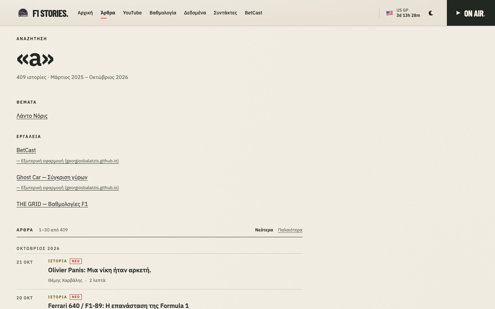
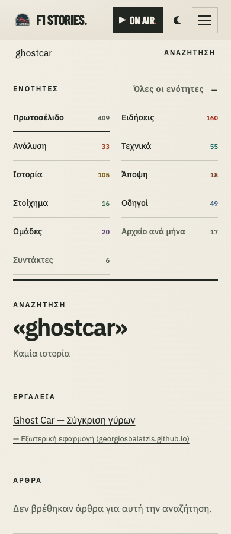

# P1.4b — Unified Search Extension

Base: `45ec0154e8d94c0f3697f67cb2442ac0f03bb090` (latest main verified before implementation).

Search now returns approved topics and curated tools before the existing article list. For example, `ghostcar` returns the application and an article-specific zero state. Article matching, normalization, sorting, category/author intersection, 30-article pagination, history and consent-gated analytics retain their existing semantics. Supplementary matches use q only; a visible note explains article-only filters.

## Publication and data boundaries

`buildHubPages` runs once in the public build. The destination generator consumes that result and requires both eligibility and a generated first page. The public validator separately requires every entity record to match an approved real public page; it rejects omitted, stale, noncanonical, noindex or redirect destinations. Only `driver:lando-norris` is currently published. Registry approvals and associations are unchanged.

The independent v1 index contains type, ID, label, href and aliases only. Records and aliases are deterministically sorted and normalized/deduplicated. Validation rejects duplicate IDs/URLs, unsupported types, wrong route shapes, excessive strings/aliases, credentials, unsafe schemes, query strings/fragments and unreviewed external destinations. Shared validation runs in the generator, browser loader, data contracts and public-artifact validator. Dynamic content uses safe DOM text construction.

Tools, verified with HTTP 200 and no HTTP redirects during review on 2026-10-22:

| Tool | Destination |
|---|---|
| THE GRID — Βαθμολογίες F1 | https://f1-stories.gr/standings/ |
| Telemetry | https://georgiosbalatzis.github.io/f1-telemetry-dashboard/ |
| Ghost Car | https://georgiosbalatzis.github.io/ghostcar/ |
| TYRES | https://georgiosbalatzis.github.io/Tyres/ |
| BetCast | https://georgiosbalatzis.github.io/BetCastVisualisation/ |

Historical external canonical declarations are unchanged. Local redirect stubs are excluded from search and remain byte-identical. The tool manifest and private entity evidence are not published.

## Loading, failure handling and budgets

Normal archive/filter/sort views request neither new asset. The first nonempty query loads the hash-versioned helper and no-store JSON: two supplementary requests. Subsequent queries reuse document memory and a shared in-flight JSON request. Destination data never enters persistent storage. A persisted pageshow clears destination memory and revalidates an active search.

The optional helper has a 400 ms coordination limit; JSON is aborted after 300 ms. Article and destination results commit together in one synchronous DOM update. A late result cannot insert above already-rendered articles; stale render tokens protect query changes, including failures. Either source can fail independently. Partial failures never claim complete global zero results.

Existing size-budget baselines, the +10% threshold and the article JSON contract are unchanged. Runtime byte savings come from equivalent arrow callbacks, dataset assignments and DOM list/spread conversions; no existing article logic moved to the helper.

| Public asset | Raw bytes | gzip bytes |
|---|---:|---:|
| `blog-module/blog-index.min.js` | 15,259 | 5,661 |
| `blog-module/search-destinations.min.js` | 5,128 | 2,051 |
| `blog-module/search-destinations.json` | 1,457 | 666 |
| `blog-module/blog-index-data.json` | 146,806 | 43,469 |

The original runtime is 15,259 B against its unchanged 13,872 B +10% allowance (maximum integer size 15,259 B). Initial runtime growth is 54 B raw / 145 B gzip relative to the audited build. Its byte allowance is exhausted.

New independent caps: JSON 4,096 B; minified helper 5,632 B; combined added transfer 7,168 B raw / 3,072 B gzip. Combined added transfer includes positive original-runtime and archive-style growth: **6,929 B raw / 2,911 B gzip**. Archive CSS grows by 290 B raw / 49 B gzip (21,830 → 22,120 B raw); it is inlined in public archive HTML and adds no request. New query-only files alone total 6,585 B raw / 2,717 B gzip. gzip is a deterministic local estimate, not a claim about server compression headers.

## Validation

Equivalent clean baseline/candidate worktrees used the same commit, Node installation and installed dependencies; neither dependency files nor scheduled workflows changed.

| Check | Baseline | Candidate |
|---|---|---|
| build:public | pass | pass |
| test:entities | 58/58 | 58/58 |
| test:blog | 326/326 + golden | 330/330 + golden |
| test:build | 131/131 | 132/132 |
| focused size-budget tests | existing gate | 4/4 |
| qa:edition | 358/358 | 491/491 with baseline comparisons |
| quality:static | pass | pass |
| perf:budget | pass | pass |
| check:assets | baseline build validated | pass |
| build:check | pass | pass after committing reviewed generated output and rebuilding |

Edition QA covers 1440px and 390px, Greek accents/final sigma, English aliases, exact destinations, grouping, destination-only/global zero states, filters, pagination/history, input focus, visible link focus, native Enter navigation, JavaScript-disabled navigation, source/helper/invalid-data failures, inert malicious labels, stale responses, storage denial, in-flight sharing and the persisted-pageshow handler. Existing analytics-consent checks still pass. Twenty direct baseline/candidate comparisons preserve article URLs, order and total count across queries, filters, sorts and pagination.

No unexpected browser console errors. Normal and delayed destination-loading CLS measured approximately 0.000221 at 1440px and 0.003321 at 390px, both under 0.1. Existing Lighthouse/CLS thresholds were not changed; full Lighthouse was not needed for this scoped change. Automated checks inspect semantic headings, native links, focus and live/status markup; no manual assistive-technology certification is claimed. Native browser BFCache eligibility is environment-dependent; the persisted-pageshow invalidation path is explicitly tested.

## Exact artifact comparison

Both public trees were inventoried by relative path and SHA-256. `artifact-comparison.json` lists every addition and changed path with hashes. Baseline: 4,093 files; candidate: 4,095. Two additions, 40 changes, no deletions, and 4,053 existing public files byte-identical.

The additions are `blog-module/search-destinations.json` and `blog-module/search-destinations.min.js`. Changes are the original search runtime, archive stylesheet and 38 archive/discovery/hub HTML files. HTML changes consist exclusively of archive asset hash references and the inlined archive stylesheet; editorial HTML is otherwise identical. Norris's approved introduction and collection content are unchanged.

All 409 article HTML files and all 3,800 files in the article source/assets tree are byte-identical. Article index JSON, sitemap, real registry/association records and redirect stubs are byte-identical. The article-tree SHA-256 manifest digest is `05bba28ec215bf1bbcdb6f24834ea237e14b6f191bf71e0da1a74e24f6949630`.

## Source changes

- `blog-module/blog-index.js`
- `blog-module/blog/archive-editorial.css`
- `blog-module/build/__tests__/search-destinations.test.js`
- `blog-module/build/index.js`
- `blog-module/build/search-destinations.js`
- `blog-module/build/search-tools.json`
- `blog-module/search-destinations.js`
- `blog-module/search-destinations.json`
- `scripts/build/__tests__/public-artifact-refs.test.mjs`
- `scripts/build/asset-sources.mjs`
- `scripts/build/generated-drift-guard.mjs`
- `scripts/build/minify.mjs`
- `scripts/build/public-artifact.mjs`
- `scripts/build/validate-data-contracts.mjs`
- `scripts/build/validate-public-artifact.mjs`
- `scripts/perf/__tests__/size-budget.test.mjs`
- `scripts/perf/edition-qa.mjs`
- `scripts/perf/size-guard.mjs`
- `scripts/perf/unified-search-qa.mjs`

## UI evidence

## Limits

An already-open document can retain approved records until a reload/BFCache restoration. A sufficiently slow optional asset produces a partial-search notice and can be retried by changing the query. External HTTP availability does not guarantee every tool's third-party data provider. External canonical cleanup is out of scope.

No merge, deployment, article rewrite, additional hub publication or P1.5 work is included.
