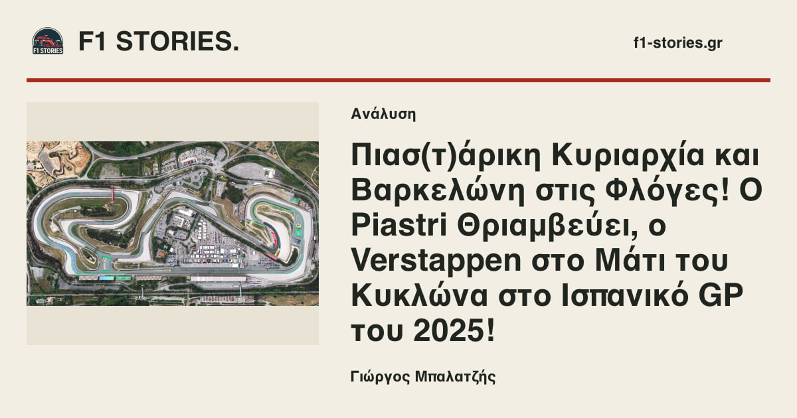

# Open Graph social cards

The Pages artifact generates a 1200×630 JPEG for each indexed article and a separate stable homepage card. The existing paper/ink/red tokens, logo and IBM Plex Sans are reused. Article images are contained, preserving diagrams, archival prints and printed captions. Only recognized taxonomy authors receive a byline; missing optional author/category metadata is omitted. Confirmed AI illustration disclosures travel with their image.

## Ownership and fallback

- `scripts/build/social-cards.mjs` runs from `public-artifact.mjs` after approved media has been copied/optimized. It reads the existing source-cache metadata and each article's original OG destination; it does not introduce another article index.
- Output JPEGs live only in `dist/images/social/`. The homepage input never depends on the latest article. URLs contain the JPEG content digest; unchanged content retains its URL.
- Only OG/Twitter image metadata is rewritten in the deployment HTML. Article HTML in Git retains its original photo fallback. Article body, hero, preload, canonical, title/description and JSON-LD are unchanged. The source homepage retains the existing 512px brand icon, independent of its lead.
- A render/encoding/source error logs a warning and leaves the article's original OG/Twitter photo in place. The homepage instead uses the stable 512px brand icon. No missing generated URL is published. Release checks validate both cards and these fallbacks.
- Approved originals remain hash-protected. The build report records the actual public source URL and SHA-256; the editorial-release checks verify that derivatives use the approved source and that JSON-LD still uses the original image.

## Cache and determinism

`.build/public-images/social-cards/` reuses the existing trusted image-cache boundary. PR jobs restore it without saving; Pages builds save it using the existing cache action. Keys include generator/font/logo/tokens, article metadata, source pixels, byte limit and native renderer versions/platform. Cached bytes are checked against their digest and JPEG dimensions before reuse. Corrupt entries are rebuilt. Changes to one article do not invalidate other cards or the homepage.

The complete pinned Greek/Latin font and local Fontconfig configuration prevent system-font substitution. Text is XML-escaped before Pango shaping. Native word/character wrapping fits actual glyph metrics; extreme synthetic titles use a grapheme-safe ellipsis at a readable 28px minimum. None of the current 408 article titles is truncated. Output is deterministic for the same pinned inputs and native rendering environment; a different renderer version/platform has its own cache identity and content digest.

## Measured impact

On Node 22.23.3 with the locked sharp dependency, using main `d42a9d5b` as baseline:

| Metric | Result |
| --- | ---: |
| New deployment JPEGs | 409 |
| Added JPEG bytes | 31,672,923 (30.21 MiB) |
| HTML metadata growth | 178,038 bytes across 409 pages |
| Largest JPEG | 122,165 bytes |
| Median JPEG | 76,914 bytes |
| Cold social-card stage | 31.8 seconds |
| Warm stage, 409 cache hits | 1.6 seconds |
| Generation fallbacks | 0 |

These are local stage timings, not a promised CI duration. No existing file-size or Lighthouse thresholds changed. Normal browsers do not preload/download these social images; hero loading and every existing runtime/media asset are unchanged. Full-artifact comparison against a clean baseline verified identical bodies, structured data, canonicals and non-social head content.

No archive card binaries are committed. The only review JPEGs in Git are the six examples below (445,190 bytes total); the build-only complete font is 202,632 bytes.

## Review examples

These are explicit typography fixtures, not new published stories or attributions. They reuse existing article images. The long title is taken from the archive; other fixture copy exercises layout and punctuation.

| Case | Preview |
| --- | --- |
| Homepage, independent of editorial lead |  |
| Short Greek title |  |
| Long Greek title |  |
| Multiple-line technical title |  |
| Missing optional author/category |  |
| Quotes, apostrophes, angle brackets and ampersand |  |

Regenerate review images with `node scripts/build/social-card-examples.mjs docs/social-cards/examples`. The renderer stays offline after checkout.

## Validation

```sh
npm ci
npm run build:public
node --test scripts/build/__tests__/social-cards*.test.mjs
npm run test:build
npm run verify
```

`report.json` in the social-card cache retains per-page source provenance, output digests, reuse counts, truncation and errors. Home/article encoder failures, corrupt caches, source/title changes, external/escaping paths, Greek wrapping and metadata escaping have dedicated tests. Category/archive share images retain their existing icon; this change targets homepage and article cards.
